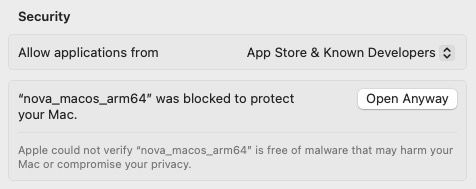
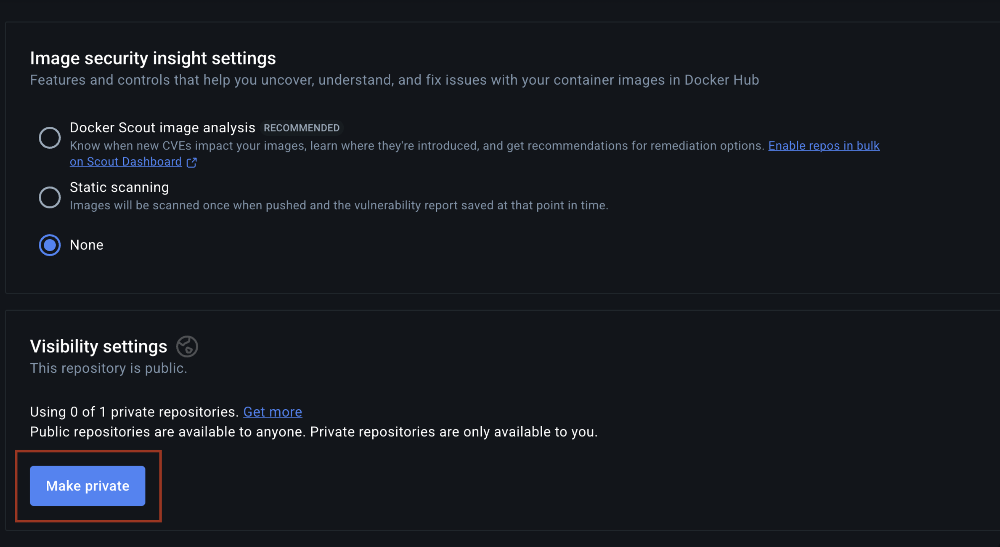

# Nova CLI

[](https://github.com/wandelbotsgmbh/nova-cli/actions/workflows/ci.yml)

The Swiss Army knife for interacting with [Wandelbots NOVA](https://www.wandelbots.com/).

The CLI helps you build and deploy applications on the NOVA platform. You can also use it to download diagnostic logs and manage your applications. Your application is built as an OCI image, pushed to the specified registry, and then deployed on the specified instance.

## Install

### MacOS/Linux

Installation with [homebrew](https://brew.sh/):
```bash
brew install wandelbotsgmbh/wandelbots/nova

# enable autocompletion for zsh (has to be done only once)
echo 'source <(nova completion zsh)' >> ~/.zshrc
```

**Note:** Our binaries are not signed yet, so macOS will block the first execution.
To fix this, go to `Settings` → `Privacy & Security` and click `Open Anyway`



### Other Platforms

Find the latest binaries at https://github.com/wandelbotsgmbh/nova-cli/releases
(`x.y.z-rc.N` prereleases are release candidates for testing, see [RELEASING.md](RELEASING.md))

Download the binary, rename it to `nova`, and make it executable. Make sure to grant the file execute permissions, as the program is not signed. Add it to your PATH and you should be ready for lift-off 🚀

[Completions are available](docs/nova_completion.md) for the most common terminals.

Or use the install script (macOS/Linux, installs to `/usr/local/bin`):

```bash
curl -fsSL https://raw.githubusercontent.com/wandelbotsgmbh/nova-cli/main/install_nova.sh | bash

# pin a version / change the target directory
curl -fsSL https://raw.githubusercontent.com/wandelbotsgmbh/nova-cli/main/install_nova.sh | NOVA_VERSION=0.0.246 INSTALL_DIR=~/.local/bin bash
```

## Setup

### Setup OCI Registry

To deploy applications, you need a container registry that NOVA can pull your apps from. We recommend the official public Docker registry for getting started quickly.

1. Create a Docker Hub account at https://hub.docker.com/signup
2. Install Docker Desktop from https://www.docker.com/products/docker-desktop/
3. Sign in to your account:
   ```bash
   docker login --username MY-DOCKER-USERNAME registry-1.docker.io
   ```
4. Configure the registry in the Nova CLI:
   ```bash
   nova config set image-registry registry-1.docker.io/MY-DOCKER-USERNAME
   ```

> [!WARNING]
> **Making Your Docker Registry Private**
> 
> If you are using Docker Hub and do not want to make your image available to the public, you can switch your Docker Hub repository to private:
> 
> 1. Go to your repository settings on Docker Hub
> 2. Switch the repository to "Make private"
> 
> 

#### Obtaining Registry Credentials (building and installing projects with `nova app install`)

By default developing/installing apps with `nova app install path/to/project` will try to obtain registry credentials from your local docker config.
This means, credentials might be leaked into a Nova instance/cell configuration.
The credentials are needed by kubernetes in order to pull images from private registries. Even public registries might need some authentication in order to prevent being rate limited.

In order to prevent your credentials from being leaked you have multiple options:

* use specific scoped access tokens when calling `docker login`
* specify pull only username and token in `.nova` file in your project
* install kubernetes secrets manually and reference them in `.nova` or provide the name via flag `nova app install yourapp -r custom-secret-name`
* omit your credentials and use Wandelbots defaults `nova app install yourapp -o`

##### Azure ACR

The Azure Container Registry normally has the following login flow:

```bash
# login to azure (only needed once)
az login

# login to acr (needed every 3 hours)
az acr login -n registryname
```

With that, docker configs will get an `IdentityToken` which is used by the Nova CLI to create a pull token,
which is only valid for a specific registry/image for a limited period of time.

### Login to Your Instance

Once you have configured your CLI, authenticate with your Nova instance:

```bash
# Login to production environment (default)
nova login

# Login to a specific environment (e.g., dev)
nova login -e dev
```

### Configure Nova CLI

Configure your Nova CLI host. For physical instances, use the IP address (e.g., `192.168.1.100`). For virtual/cloud instances, use the URL (e.g., `my.instance.wandelbots.io`).

for cloud instances:
```bash
# create instance if not exists yet
nova instance create --name my-instance

# listing instances
nova instance list

# selecting an instance
nova instance select instanceid
```

manually setting the instance:
```bash
# For cloud instances
nova config set host your_instance_id.instance.wandelbots.io

# For physical instances  
nova config set host 192.168.1.100
```

## Usage

For an overview and description of all available commands have a look at the [docs](docs/nova.md).

### Autocompletion on macOS zsh

We observed some strange behavior on mac using zsh, that autocompletion will not work out of the box. 
One needs to call the following and autocompletion will start to work.
```bash
# could be placed into ~/.zshrc
source <(nova completion zsh)
```
[kubectl](https://github.com/kubernetes/kubernetes/blob/bf8c918e0be340637e63520eb3b58df493a230f9/staging/src/k8s.io/kubectl/pkg/cmd/completion/completion.go#L174-L175) seems to have a hack to solve this

## App Store

We have a catalog of applications ready for you to install! We publish pre-built applications in our [catalog](https://github.com/wandelbotsgmbh/catalog), which you can install directly to your Nova instance.

```bash
# list available entries
$ nova catalog list
jupyter
rerun
zivid-intel

# show information about an entry
$ nova catalog info jupyter
Jupyter is a free, open-source, ...

# install an entry to your instance
$ nova catalog install jupyter
```

## App Templates

Nova CLI provides several application templates to help you get started quickly with different types of applications.

### Creating and Installing Apps

**Creating Applications:**

To create a new application, run:
```bash
nova app create my-app
```

> **💡 Tip:** If you're already logged in when you create an app, the `.env` file will automatically contain your authentication token and NOVA_API configuration, so you can start working with it immediately!

**Available App Templates:**

Nova CLI supports different application generators using the `-g` flag:

- `novax_app` - NovaX application template (default)
- `nextjs_app` - Next.js with TypeScript support

**Example Usage:**

```bash
# Create a TypeScript/Next.js app
nova app create 'my-typescript-app' -g "nextjs_app"

# Create a NovaX app (default)
nova app create 'my-novax-app' -g "novax_app"

# or simply (uses novax_app as default)
nova app create 'my-novax-app'
```

**Valid App Names:**
Your app name must follow these rules:
- Must start with a letter (a-z or A-Z)
- Can contain letters, numbers, and hyphens (-)
- Cannot be empty
- Examples: `my-app`, `RobotController`, `sensor-data-processor`

**Installing Your Application:**

Once created and logged in, install your application with:
```bash
nova app install my-app
```

### NovaX Applications

NovaX Applications are Python projects built with uv and FastAPI. It comes with default FastAPI routes but gives you full control over the FastAPI application. This is the fastest way to create custom applications with your robotics programs, powered by our Python SDK.

The NovaX application comes with default GitHub Copilot prompts so you can develop a robotics application and deploy it to your Nova instance with the help of Copilot, without writing a single line of code.

Learn more about NovaX Applications: https://github.com/wandelbotsgmbh/wandelbots-nova?tab=readme-ov-file#novax

### TypeScript Application

The TypeScript Application is a Next.js application that comes with ready-to-use React components specifically designed for robotics applications. This template provides a solid foundation for building modern web interfaces for your Nova applications.

The Next.js template (`nextjs_app`) includes TypeScript configuration (`tsconfig.json`) and provides a full TypeScript development environment with Next.js framework support.

Learn more about the React components: https://github.com/wandelbotsgmbh/wandelbots-js-react-components

### Open Homescreen

```bash
$ nova homescreen
```

### Manage Your Cell

```bash
# save the current default cell to a file
$ nova cell save

# edit the cell YAML in your favorite editor
$ nova cell edit

# install a cell from a file
$ nova cell install path/to/your/cell.yaml
```

## Installing without a registry (`--copy-image`)

For instances that can't pull from your registry (air-gapped, shop-floor networks), `--copy-image` skips the registry entirely: it builds the image, copies it to the instance over ssh/scp, and imports it straight into k3s' containerd.

```bash
nova app install path/to/app --copy-image --ssh-user <user>
```

* Uses the configured `host` as the ssh target; works with both docker and podman.
* Only the image layers the instance is missing are transferred, so repeated installs are fast.
* First time per instance, add `--setup-ssh-key` to install your ssh key and a passwordless-sudo rule for k3s on the target. It prompts once for the ssh and sudo password (the sudo prompt is unavoidable — sudo is needed once to grant passwordless sudo); every install after that runs prompt-free:

```bash
nova app install path/to/app --copy-image --ssh-user <user> --setup-ssh-key
```

Other flags: `--ssh-port`, `--no-sudo` (root login, skips sudo entirely), `--import-command` (default `k3s ctr images import`), `--remote-dir` (default `/tmp`).

## Contributing

See [CONTRIBUTING.md](CONTRIBUTING.md). Security issues: see [SECURITY.md](SECURITY.md).

## License

[Apache-2.0](LICENSE)
