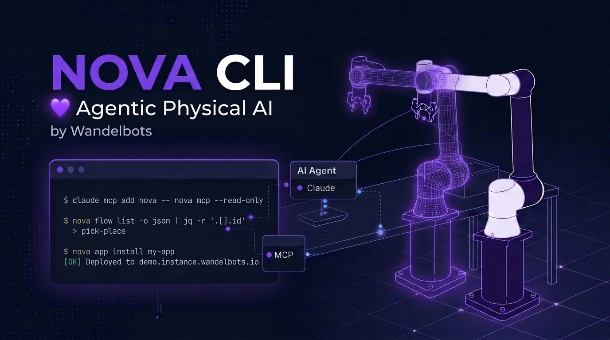
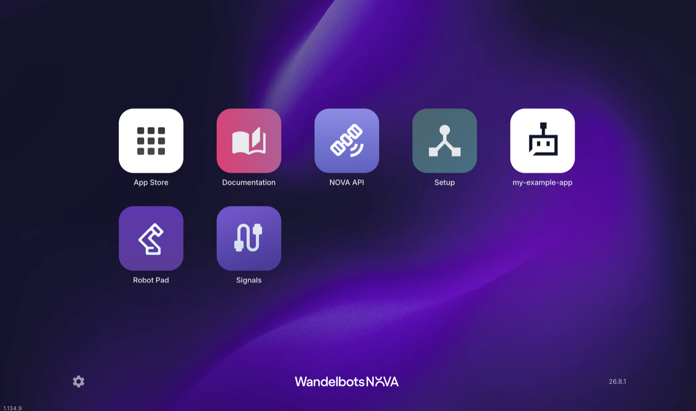
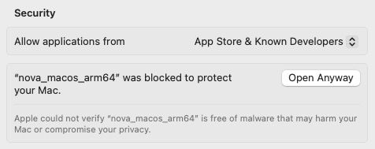
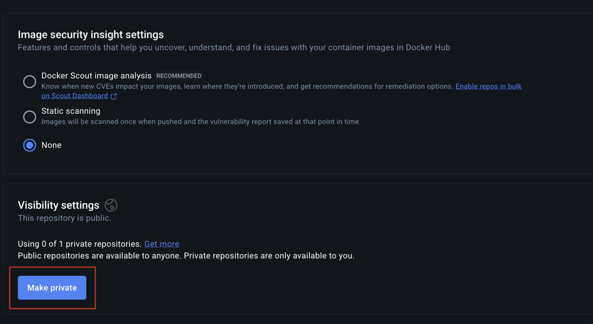

# Nova CLI



[](https://github.com/wandelbotsgmbh/nova-cli/releases/latest)
[](https://github.com/wandelbotsgmbh/nova-cli/actions/workflows/ci.yml)
[](LICENSE)
[](https://wandelbotsgmbh.github.io/nova-cli/)

`nova` is the command line for [Wandelbots NOVA](https://www.wandelbots.com/), the platform for programming industrial robots of any brand. Create a robot app, deploy it to a NOVA instance in the cloud or on the shop floor, install apps from the catalog, edit NovaFlow flows, and pull diagnostics — from your terminal, from scripts and CI, or from a coding agent like Claude Code or Cursor.

From the terminal to the cell:


...and the app shows up right on the instance's homescreen:



## Quickstart

You need a Wandelbots account on [portal.wandelbots.io](https://portal.wandelbots.io) for a cloud instance, or a NOVA instance on your network.

```bash
brew install wandelbotsgmbh/wandelbots/nova   # other platforms: see Install below

nova login                                    # log in to portal.wandelbots.io
nova instance create --name my-instance       # a cloud instance with NOVA, selected for all further commands
                                              # (on-premise: nova instance add lab --host 192.168.1.10)
nova catalog install jupyter                  # install a ready-made app from the catalog
nova homescreen                               # open the instance in your browser
```

Then build your own app ([needs a container registry](#container-registry)):

```bash
nova app create my-app                        # Python app (also: -g nextjs_app, golang_app, rust_app)
nova app install my-app                       # build, push and deploy it to the instance
```

## Use it with your coding agent

The CLI is built for agents as much as for people: data goes to stdout, messages to stderr, and data commands take `-o json`. On top of that:

```bash
# MCP server with curated tools for your instance: cells, controllers, apps, diagnosis, kinematics, …
claude mcp add nova -- nova mcp --read-only
claude mcp add nova -- nova mcp --toolsets default,planning,motion   # motion runs on virtual controllers only

# author NovaFlow flows from the agent
claude mcp add novaflow -- nova flow mcp

# any endpoint of the instance API, authenticated, discoverable by the agent itself
nova api search controllers
nova api /api/v2/cells/{cell}/controllers
```

`nova mcp` works with any MCP client (Cursor, VS Code, …): the command is `nova mcp`, over stdio. `--debug` shows HTTP traffic and external commands when something goes wrong. Design decisions behind this: [docs/decisions](docs/decisions/README.md).

## What else it does

| | |
|---|---|
| **Apps** | `nova app create/install`, templates for Python ([NovaX](https://github.com/wandelbotsgmbh/wandelbots-nova?tab=readme-ov-file#novax)), TypeScript/Next.js ([React components](https://github.com/wandelbotsgmbh/wandelbots-js-react-components)), Go and Rust; [registry-less installs](#installing-without-a-registry---copy-image) for air-gapped networks |
| **Catalog** | `nova catalog list/info/install`: ready-made apps, drivers and cameras from the [catalog](https://github.com/wandelbotsgmbh/catalog) |
| **Instances** | `nova instance create/list/select/add`: cloud and on-premise instances side by side, `--instance <name>` per command |
| **Cells** | `nova cell save/edit/install`: the cell setup as YAML in your editor |
| **NovaFlow** | `nova flow`: install NovaFlow, open the editor, read, edit, back up and restore flows |
| **Diagnosis** | `nova diagnosis`, `nova backup`: diagnosis packages and backups |

All commands: [CLI reference](https://wandelbotsgmbh.github.io/nova-cli/) or `nova <command> --help`.

## Install

All options install a single `nova` binary. Check with `nova version` afterwards.

### macOS / Linux: Homebrew

The recommended way on both macOS and Linux ([Homebrew on Linux](https://docs.brew.sh/Homebrew-on-Linux)); the formula ships `amd64` and `arm64` builds for either OS:

```bash
brew install wandelbotsgmbh/wandelbots/nova
```

> [!NOTE]
> Our binaries are not signed yet, so macOS may block the first execution. To allow it, go to `Settings` → `Privacy & Security` and click `Open Anyway`.
>
> 

### macOS / Linux: install script

Installs the latest stable release to `/usr/local/bin` (uses `sudo` only if that directory is not writable):

```bash
curl -fsSL https://raw.githubusercontent.com/wandelbotsgmbh/nova-cli/main/install_nova.sh | bash
```

Pin a version or install into a user directory without `sudo`:

```bash
curl -fsSL https://raw.githubusercontent.com/wandelbotsgmbh/nova-cli/main/install_nova.sh | NOVA_VERSION=0.5.0 INSTALL_DIR=~/.local/bin bash
```

### Windows

Download `novacli_win64-<version>.zip` from the [releases page](https://github.com/wandelbotsgmbh/nova-cli/releases), extract `nova.exe` and put it on your `PATH`, e.g. in PowerShell:

```powershell
$v = "0.5.0"
Invoke-WebRequest -Uri "https://github.com/wandelbotsgmbh/nova-cli/releases/download/$v/novacli_win64-$v.zip" -OutFile "$env:TEMP\nova.zip"
Expand-Archive "$env:TEMP\nova.zip" -DestinationPath "$env:LOCALAPPDATA\nova"
[Environment]::SetEnvironmentVariable("Path", "$env:LOCALAPPDATA\nova;" + [Environment]::GetEnvironmentVariable("Path", "User"), "User")
```

Open a new terminal afterwards so the updated `PATH` is picked up.

### Manual download (all platforms)

Every [release](https://github.com/wandelbotsgmbh/nova-cli/releases) ships archives for `linux_amd64`, `linux_arm64`, `macos_amd64`, `macos_arm64` and `win64`, each containing just the `nova` binary.
`x.y.z-rc.N` prereleases are release candidates for testing, see [RELEASING.md](RELEASING.md).

```bash
VERSION=0.5.0 ARCH=amd64   # or arm64
curl -fLO https://github.com/wandelbotsgmbh/nova-cli/releases/download/$VERSION/novacli_linux_$ARCH-$VERSION.tar.gz
mkdir -p ~/.local/bin
tar -xzf novacli_linux_$ARCH-$VERSION.tar.gz -C ~/.local/bin nova   # add ~/.local/bin to your PATH if needed
```

### Docker

```bash
docker run --rm ghcr.io/wandelbotsgmbh/nova-cli:latest version
```

Images are published for `linux/amd64` and `linux/arm64`, tagged `latest` (stable) and `<version>` (including `x.y.z-rc.N` prereleases).
Mount a config to keep instances and login between runs, e.g. `-v ~/.nova:/root/.nova`.

### Shell completion

```bash
# zsh: add this line to ~/.zshrc (plain `nova completion zsh > …` setups often don't load on macOS)
source <(nova completion zsh)
# bash, fish, powershell
nova completion --help
```

## Instances

`nova login` logs in to [portal.wandelbots.io](https://portal.wandelbots.io). The CLI keeps a list of instances and works against the selected one:

```bash
nova instance create --name my-instance        # new cloud instance, selected
nova instance list
nova instance select <name>                    # a cloud instance id works too
nova instance add lab --host 192.168.1.10      # an on-premise instance (IPC) on your network
nova --instance lab cell save                  # one command against another instance
```

## Building apps

```bash
nova app create my-app -g python_app           # default; also nextjs_app, golang_app, rust_app
nova app install my-app                        # build the image, push it, deploy it to the cell
```

The project gets a gitignored env file with the instance, cell and access token, so it runs locally against the instance right away; `nova app update-env` refreshes the token. App names start with a letter and contain only letters, digits and hyphens.

- **Python** ([NovaX](https://github.com/wandelbotsgmbh/wandelbots-nova?tab=readme-ov-file#novax)): uv + FastAPI with the NOVA Python SDK, robot programs included, plus Copilot prompts to develop it with an agent.
- **TypeScript** (`nextjs_app`): Next.js with the [Wandelbots React components](https://github.com/wandelbotsgmbh/wandelbots-js-react-components).
- **Go** (`golang_app`) and **Rust** (`rust_app`): a small web server with an OpenAPI spec and a minimal NOVA API client.

### Container registry

`nova app install` builds an OCI image (docker or podman, auto-detected) and pushes it to your registry, from where the instance pulls it. To get started quickly, use Docker Hub:

```bash
docker login registry-1.docker.io
nova config set image-registry registry-1.docker.io/<your-docker-user>
```

> [!WARNING]
> Images on Docker Hub are public unless you make the repository private in its settings:
>
> 

**Registry credentials.** By default the CLI takes the pull credentials from your local docker config and stores them in the cell, so the instance can pull from private registries. To keep your own credentials out of the instance:

* use scoped access tokens for `docker login`
* put a pull-only username and token in the project's `.nova` file
* create a Kubernetes secret in the cell yourself and reference it in `.nova` or with `--registry-secret <name>`
* use the Wandelbots default pull secrets with `--omit-credentials` (`-o`)

**Azure Container Registry:** after `az login` and `az acr login -n <registry>` (valid for 3 hours), the CLI turns the docker config's identity token into a pull token limited to that image and time.

### Installing without a registry (`--copy-image`)

For instances that can't pull from your registry (air-gapped, shop-floor networks), `--copy-image` skips the registry entirely: it builds the image, copies it to the instance over ssh/scp, and imports it straight into k3s' containerd.

```bash
nova app install path/to/app --copy-image --ssh-user <user>
```

* Uses the instance's host as the ssh target; works with both docker and podman.
* Only the image layers the instance is missing are transferred, so repeated installs are fast.
* First time per instance, add `--setup-ssh-key` to install your ssh key and a passwordless-sudo rule for k3s on the target. It prompts once for the ssh and sudo password (sudo is needed once to grant passwordless sudo); every install after that runs prompt-free.

Other flags: `--ssh-port`, `--no-sudo` (root login, skips sudo entirely), `--import-command` (default `k3s ctr images import`), `--remote-dir` (default `/tmp`).

## Contributing

Issues and pull requests are welcome, see [CONTRIBUTING.md](CONTRIBUTING.md). Security issues: see [SECURITY.md](SECURITY.md).

## License

[Apache-2.0](LICENSE)
